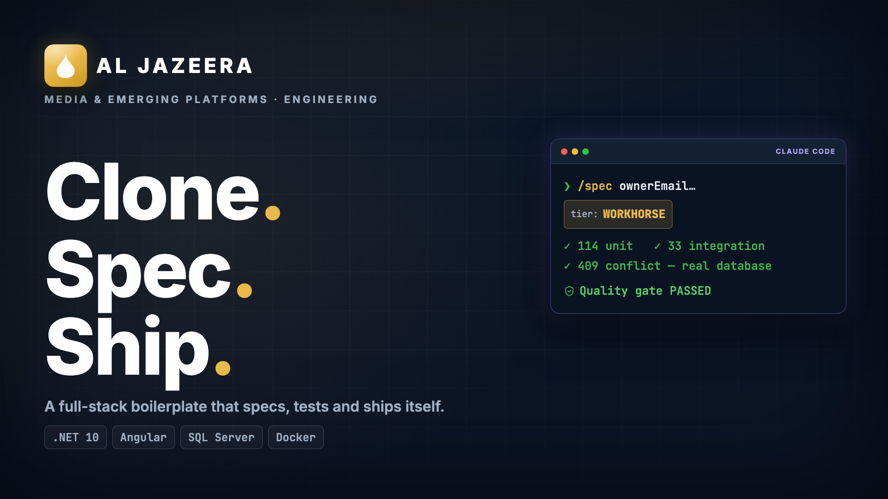
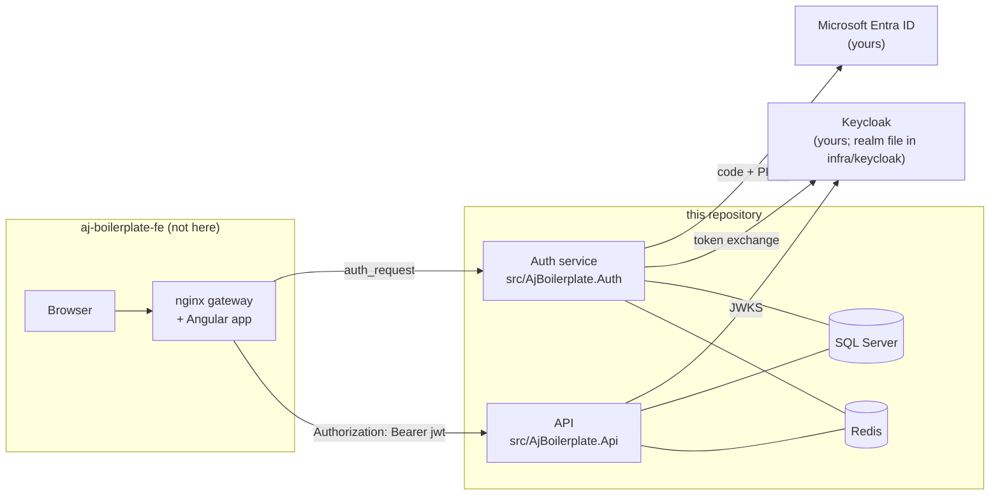

<div align="center">



# Agentic Backend Boilerplate

**A .NET 10 API and a sign-in service that ship with their own engineering guardrails.**

[](https://dotnet.microsoft.com/)
[](https://learn.microsoft.com/ef/core/)
[](https://www.keycloak.org/)
[](#licence)

</div>

---

## What this is

1. A **.NET 10 API** with layered Clean Architecture, EF Core on SQL Server, a uniform
   `ApiResponse<T>` envelope and a committed OpenAPI contract that clients generate code from.
2. An **Auth service** (`AjBoilerplate.Auth`) that signs users in with Microsoft Entra ID and mints
   a Keycloak JWT for the API, so the browser never holds a token. It also carries the user-admin
   routes (`/internal/admin/*`, over Keycloak's Admin REST API), a cross-portal hand-off, the
   Pub/Sub `/auth/events` push and a session-ended outbox; the API carries the matching sign-in
   history, session-ended receiver, `/api/v1/me/portals` and an `/api/v1/admin/*` proxy. Each is
   off or 404 until configured ([docs/auth/setup.md](docs/auth/setup.md#5-configuration-reference)).
3. A **quality gate and a committed `.claude/` harness** that enforce the rules instead of
   describing them.

It contains **no business domain**. The sample `Item` is meant to be deleted on day one; the
"What's new" spotlight is domain-free plumbing worth keeping.

> **This is the backend half of a three-repository set.** The browser app and the **gateway nginx**
> live in [`aj-boilerplate-fe`](https://github.com/Emadkhanqai/aj-boilerplate-fe); both together
> are [`aj-boilerplate-fs`](https://github.com/Emadkhanqai/aj-boilerplate-fs), which also has the
> one-command local stack with sign-in. These repositories are derived from `fs`
> ([ADR-0006](docs/adr/0006-three-repository-split.md)): change `fs`, not this one.

## What is in this repository, and what is not



| Here | Not here |
|---|---|
| API, Auth service, their tests, EF migrations | The Angular app and the **nginx gateway** (`aj-boilerplate-fe`) |
| `docker-compose.yml` for `db`, `redis`, `api`, `migrate` | A compose file that also starts Keycloak, the Auth service and the gateway (`aj-boilerplate-fs`) |
| `infra/keycloak/` (the dev-only realm) and `infra/gcp`, `infra/azure` (API only) | Anything that deploys the Auth service or the gateway: no tree does |

## Quickstart (about 5 minutes)

**Prerequisites:** the **.NET SDK 10** (`global.json` pins `10.0.100`, newer feature bands are
accepted) and **Docker** (for SQL Server and Redis, and for the integration suite).

```bash
git clone https://github.com/Emadkhanqai/aj-boilerplate-be.git
cd aj-boilerplate-be

cp .env.example .env               # then set MSSQL_SA_PASSWORD (any strong local value)
export CLOUD_PROVIDER=gcp          # or: azure
export ConnectionStrings__Default='Server=localhost,1433;Database=AjBoilerplate;User Id=sa;Password=<your-local-password>;TrustServerCertificate=True;'
export ConnectionStrings__Redis='localhost:6379'
export APP_DB_CONNECTION="$ConnectionStrings__Default"   # what the design-time factory reads

docker network create app-net      # once per host
docker compose up -d db redis

dotnet tool restore                # dotnet-ef, pinned in .config/dotnet-tools.json
dotnet ef database update \
  --project        src/AjBoilerplate.Infrastructure \
  --startup-project src/AjBoilerplate.Api

dotnet run --project src/AjBoilerplate.Api     # http://localhost:5080
```

Open <http://localhost:5080/swagger>. **Every protected endpoint answers `401` until you point the
API at a Keycloak** (`Keycloak__ValidIssuer`, `Keycloak__JwksUri`, `Keycloak__ClientId`). That is the
correct answer, not a broken install: the API accepts only a Keycloak JWT whose `azp` equals
`Keycloak__ClientId`. `GET /health/ready` needs no token.

Prove the gate is green before you change anything:

```bash
dotnet build  -warnaserror
dotnet format --verify-no-changes
dotnet test                        # unit, architecture, Auth.Tests; the integration suite needs Docker
```

## Authentication, for a backend-only checkout

Read [docs/auth/README.md](docs/auth/README.md) for the whole model. In one paragraph: nginx (in the
frontend) checks an opaque session cookie against the **Auth service**, which holds the Entra and
Keycloak tokens and hands nginx a Keycloak JWT; nginx forwards it to the API as
`Authorization: Bearer`. The API validates the JWT and enforces roles with policies (a seat **or** a
permission). `GET /api/v1/me` returns the caller's capabilities.

**Where is the gateway?** In `aj-boilerplate-fe` (`docker/nginx/`), not here. What to do:

| You want | Do this |
|---|---|
| The whole thing running locally, with sign-in, now | Use [`aj-boilerplate-fs`](https://github.com/Emadkhanqai/aj-boilerplate-fs): `docker compose up --build` starts Keycloak, the Auth service, the API and the gateway with seeded users |
| To call the API from tests or `curl` | Obtain a JWT from your Keycloak for the API's client and send it as `Authorization: Bearer`. The integration tests do the equivalent with a test authentication handler |
| A real deployment outside Al Jazeera USP | Run the frontend repository's container with `AUTH_PROVIDER=embedded` in front of the API and the Auth service, and follow [docs/auth/setup.md](docs/auth/setup.md). **Untested from this derived repository.** |
| A deployment inside Al Jazeera USP | Set `AUTH_PROVIDER=usp` on the web container, **do not deploy the Auth service**, and ask the USP platform team to onboard your host ([setup, section 3](docs/auth/setup.md#3-onboarding-into-usp-auth_providerusp)) |

**Running the Auth service from here:**

```bash
dotnet run --project src/AjBoilerplate.Auth                                # http://localhost:5090
docker build -f src/AjBoilerplate.Auth/Dockerfile .                        # the image
```

It needs SQL Server (database with schema `auth`, applied by its own migration), Redis, an Entra
app registration and a Keycloak, supplied as environment variables. The user-admin routes also need a
Keycloak admin client (a service account), and the session-ended hop a receiver key shared with the API
([session-ended contract](docs/auth/session-ended-contract.md)); the local stack in `aj-boilerplate-fs`
wires both with dev-only values. The full table of keys and
defaults is in [docs/auth/setup.md](docs/auth/setup.md#5-configuration-reference); the service's own
page is [src/AjBoilerplate.Auth/README.md](src/AjBoilerplate.Auth/README.md). The Auth service does
not read Secret Manager or Key Vault: your platform injects its secrets as environment variables.
`infra/gcp` and `infra/azure` provision the API, its database, Redis and secrets, and **nothing
deploys the Auth service**; that is the adopting project's work.

## Repository map

```
.
├── README.md · README.be.md  this file · the engineering reference (migrations, idempotency, flags, storage)
├── CLAUDE.md                 project context for Claude Code: read first
├── AjBoilerplate.slnx · global.json · Directory.Build.props
├── Dockerfile · docker-compose.yml        the API image · db, redis, api, migrate
├── src/
│   ├── AjBoilerplate.Domain/ · Application/ · Contracts/ · Infrastructure/ · Api/   the layered API
│   └── AjBoilerplate.Auth/                 the Auth service: independent of the five above
├── tests/
│   ├── AjBoilerplate.UnitTests/ · IntegrationTests/ (Docker) · ArchitectureTests/
│   └── AjBoilerplate.Auth.Tests/           fakes, no Docker
├── docs/
│   ├── auth/                 how sign-in works, setup, troubleshooting, the contract
│   ├── adr/ · api/ · specs/ · incidents/ · handoff/
│   └── architecture.md · onboarding.md · workflow.md · upgrading.md · definition-of-done.md
├── infra/
│   ├── keycloak/             the DEV-ONLY realm
│   ├── gcp/                  Terraform: Cloud Run (API), Cloud SQL, Memorystore, Secret Manager
│   └── azure/                Bicep: Container Apps (API), Azure SQL, Cache for Redis, Key Vault
├── scripts/                  generate-openapi.sh (the contract)
├── .claude/                  agents, commands, hooks, standards, templates
└── .github/workflows/        backend-ci · supply-chain · deploy
```

## Common tasks

**Add an endpoint with a policy.** Copy `src/AjBoilerplate.Api/Controllers/ItemsController.cs`. Every
controller declares `[Authorize(Policy = ...)]` (`ReadAccess`, `WriteAccess`, `AdminAccess`) or an
explicit `[AllowAnonymous]`; an architecture test fails otherwise, and the fallback policy denies
anything that declares nothing. Then run `./scripts/generate-openapi.sh` and commit the contract.

**Add a permission.** Add the Keycloak client role, add the constant to `Permissions` and
`Permissions.All`, give it a policy, and tell the frontend. The steps are in
[docs/auth/setup.md](docs/auth/setup.md#4-roles-and-permissions-end-to-end).

**Add a migration.** Use `/new-migration`; it reviews the SQL first. Rules (expand, migrate,
contract) are in [README.be.md](README.be.md#the-zero-downtime-rule-expand--migrate--contract).

## Troubleshooting

| Symptom | Likely cause and fix |
|---|---|
| Every protected endpoint is `401` | No Keycloak configured, or the token's `azp` differs from `Keycloak__ClientId`, or `ValidIssuer` is not the token's exact `iss`. See [docs/auth/troubleshooting.md](docs/auth/troubleshooting.md). |
| API refuses to start: "`Keycloak:JwksUri` is not an https URL" | Outside Development a plaintext JWKS is refused. Use https, or set `Keycloak__AllowInsecureJwksTransport=true` with a dated, written reason. |
| `db` unhealthy or never ready | A stale `app-db-data` volume with another `sa` password. `docker compose down -v`, then start again. |
| `dotnet ef` writes to the wrong database | The design-time factory reads `APP_DB_CONNECTION`, not `ConnectionStrings__Default`. |
| "network app-net declared as external, but could not be found" | `docker network create app-net` (once per host). |

## Making it yours

1. Rename `AjBoilerplate` everywhere: the six project folders under `src/` (including
   `AjBoilerplate.Auth`), the four under `tests/`, `AjBoilerplate.slnx`, namespaces, the `.csproj`
   names and the `sonar.projectKey`.
2. Delete the sample `Item` slice (see [CLAUDE.md](CLAUDE.md)); keep the architecture tests.
3. Pick the auth provider and the cloud (`AUTH_PROVIDER`, `CLOUD_PROVIDER`), and replace the seats and
   permissions with your own.
4. Replace this README, continue the ADR series at `0013`, and delete the `infra/` tree you do not use.

## Related repositories

| Repository | Contents |
|---|---|
| [`aj-boilerplate-fs`](https://github.com/Emadkhanqai/aj-boilerplate-fs) | Source of truth: backend, frontend and infra, with the one-command local stack |
| [`aj-boilerplate-be`](https://github.com/Emadkhanqai/aj-boilerplate-be) | This repository |
| [`aj-boilerplate-fe`](https://github.com/Emadkhanqai/aj-boilerplate-fe) | The Angular app and the nginx gateway |

## CI configuration

The workflows in `.github/workflows/` need repository settings that are **not** included.
Cloud authentication uses GitHub OIDC: there are no long-lived cloud credentials in any workflow,
and none should be added.

**Repository variables:** `CLOUD_PROVIDER` (`gcp` | `azure`), `SONAR_HOST_URL` and
`SONAR_PROJECT_KEY` (the quality-gate job skips itself while the first is unset), `API_IMAGE`,
`NAME_PREFIX`, `GCP_PROJECT_ID`, `GCP_REGION`, `TF_STATE_BUCKET`, `AZURE_LOCATION`,
`AZURE_NAME_PREFIX`, `AZURE_SQL_ADMIN_OBJECT_ID`, `AZURE_SQL_ADMIN_LOGIN`,
`CLOUDSQL_INSTANCE_CONNECTION_NAME`, `DB_NAME`, `DB_USER`, `DB_PASSWORD_SECRET`,
`AZURE_SQL_SERVER`, `AZURE_SQL_DATABASE`, `AZURE_RESOURCE_GROUP`.

**Repository secrets:** `SONAR_TOKEN`, `GCP_WORKLOAD_IDENTITY_PROVIDER`, `GCP_SERVICE_ACCOUNT`,
`AZURE_CLIENT_ID`, `AZURE_TENANT_ID`, `AZURE_SUBSCRIPTION_ID`, and optionally `GITLEAKS_LICENSE`.

**Environments:** create `dev`, `staging` and `prod`; add required reviewers to `staging` and
`prod`. Those protection rules are the approval gates in `deploy.yml`. Migrations run before every
rollout from a bundle built by `backend-ci.yml`. The `deploy` workflows roll out **only the API
image**.

## Contributing

Read [CONTRIBUTING.md](CONTRIBUTING.md), then [docs/workflow.md](docs/workflow.md) and
[docs/definition-of-done.md](docs/definition-of-done.md). Spec first, failing test first, small
diffs, a green gate, and a human reviews every change, including the ones an agent wrote. Commits
follow Conventional Commits, enforced by `.claude/hooks/commit-msg.sh`.

## Licence

All rights reserved; the licence choice is pending. See [`LICENSE`](LICENSE).
